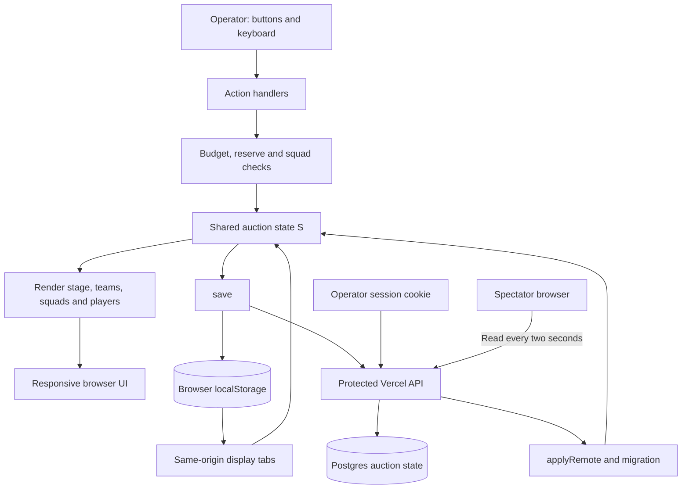
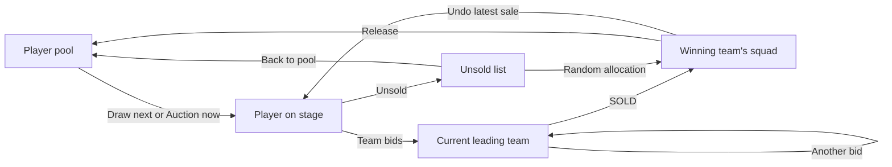

# GTS Cricket League — Season 2

A responsive cricket player auction dashboard for running a league auction from a laptop, following it on a phone, or presenting it on a large screen. Built with HTML, vanilla JavaScript, and locally compiled Tailwind CSS.


## Auction experience

- **Live auction stage:** player name, category, base price, current bid, and a large team-colored panel identifying the leading team and its owners.
- **Team bidding controls:** place bids with buttons or number keys; view remaining purses, roster counts, and the leading team.
- **11-player squads:** pre-signed players count toward the squad size. Full squads cannot acquire another player through bidding, random allocation, or the player editor.
- **Player management:** filter the pool, edit player details, assign teams, release players, re-auction players, and return unsold players to the pool.
- **Sale announcements:** show the player's name, winning team, owners, and final price in a dismissible result dialog.
- **Undo controls:** undo the latest bid or sale. Bid history is retained internally for undo; the small history strip beneath the leading team is intentionally omitted.
- **Presentation and display modes:** hide operator controls for a cleaner audience view, with a touch-friendly exit from presentation mode.
- **Live spectator link:** `/watch` is view-only; `/auth` signs in the operator. Shared state is protected by the server and delivered to spectators on a two-second refresh interval once live hosting is configured.
- **Responsive and accessible layouts:** wrapping names, labeled fields, visible keyboard focus, large touch targets, reduced-motion support, and scrollable result dialogs.

### Leading team display

The current leader is the main visual feature beneath the price. It uses the team's color, a large team name, and bracketed owner names. Each new bid or undo updates this panel.


### Mobile views

These are captures of the working interface in an isolated browser session using the included player records.

<p>
  
  
</p>

<details>
<summary>View an 11-slot squad card on mobile</summary>


</details>

## Run locally

Use Node.js 22 or later with npm. From the repository directory:

```bash
npm ci
npm run build
npm run dev
```

Open **http://127.0.0.1:4173**. The preview serves the current source files; rerun the build after changing Tailwind classes or styles, then refresh the browser. Stop the preview with `Ctrl+C`.

Without `.env.local`, this is a device-local preview. To test cross-device behavior, configure the live backend below. The preview server reads `.env.local` automatically when present.

The generated stylesheet is committed in `assets/styles.css`, so the HTML can also be served by a basic static server. Styling does not depend on a Tailwind CDN. The existing Google Fonts link loads Bebas Neue and Rajdhani when available, with local font fallbacks.

## Running an auction

1. Open **Setup** to review team names, owners, purse, squad size, bid increment, reserve, and the player list. Applying setup resets the auction and requires a second click on its reset button.
2. Open **Auction**, optionally choose a category, and select **Draw next**.
3. Select a team to place its bid. The price and large leading-team panel update immediately.
4. Select **SOLD** to assign the player to the leading team, or **Unsold** to move the player to the unsold list.
5. Review rosters under **Squads**. Use **Players** and **Unsold** for individual changes or the accelerated round.
6. Use **Show results CSV** under Setup to display the team/player/category/price export for copying.

The starting configuration is a **₹2,00,000 purse**, **11 slots per team**, **₹1,000 bid increment**, and **₹2,000 female-player reserve**. The reserve reduces a team's available bidding budget until its roster includes a female player, except when bidding for a female player.

The initial teams are:

- **Team A** (Tejas & Rohit)
- **Team B** (Avneesh & Vinay)
- **Team C** (Manmohan, Nahas & Priya Singh)
- **Team D** (Rakshit & Pallavi)
- **Team E** (Ashutosh & Alok)
- **Dhurandhar** (Sudip & Kunal)

Team names, owners, and colors can be edited in Setup. The setup parser supports up to eight teams; that team count is separate from the 11 slots per squad.

### Keyboard controls

Shortcuts work outside editable fields. Auction action shortcuts apply on the Auction view.

- `1`–`8`: place a bid for the corresponding team.
- `N`: draw the next player.
- `S` or `Enter`: sell to the leading team.
- `U`: mark the current player unsold.
- `Z`: undo the latest bid.
- `X`: undo the latest sale.
- `M`: toggle sound.
- `H`: toggle presentation mode.
- `Escape`: dismiss an open result dialog.

**Present** hides operator controls in the current tab. **Open display** opens the same auction at `#display` in another tab and follows its stored Auction/Squads view. Display mode also blocks editing. **Copy viewing link** copies `/watch`, where spectators can switch between Auction and Squads without changing the operator's view. Copying is enabled when live storage is connected.

## Live hosting setup

The intended production links are:

- Spectators: `https://gts-five.vercel.app/watch`
- Operator: `https://gts-five.vercel.app/auth`

These routes require this version to be deployed and the server environment configured. Adding `/watch` or `#display` to the old static deployment does not enable cross-device updates or server-side access control.

1. Connect a Neon Postgres database to the Vercel project and set the server-only **`DATABASE_URL`** environment variable. Use an isolated development branch for testing before configuring the production database.
2. Set **`AUCTION_ADMIN_PASSWORD`** to a unique, randomly generated password of at least 16 characters. Share it only with auction operators. Keep both values in Vercel environment variables; do not put them in HTML, Git, a viewing URL, or a chat message.
3. Apply the tracked schema once using a direct database connection in `MIGRATION_DATABASE_URL` (or the database SQL editor). The migration only creates `gts_auction_state` if absent; it does not reset data:

```bash
npm run db:migrate
```

4. Deploy this repository to the existing Vercel project. Static assets come from `dist/`; `api/auction.mjs` and `api/session.mjs` run as Vercel functions.
5. Open `/auth` in the browser that already has the auction progress, then sign in. If the database is empty, the operator's current browser state is published. If shared state already exists, that state is loaded instead.
6. Copy the viewing link and verify it in another browser or phone. Spectators need no password and cannot place bids, sell players, edit squads, or reset the auction.

For local development, copy `.env.example` to the ignored `.env.local`, configure its values, apply the schema, then run `npm run dev`. On a deployed site, absent configuration fails closed with an explanatory notice; the app does not silently enable editing.

### Access protection

- Anonymous users can read `/api/auction`; all writes require an operator session.
- The operator password is verified on the server. The browser receives a signed, 12-hour HttpOnly session cookie with SameSite=Strict and Secure on production HTTPS.
- Writes and sign-in check the request origin. Request size, state shape, and expected version are validated; conflicting updates return the latest state rather than silently overwriting another operator.
- Removing `/watch`, restoring hidden controls, or sending an anonymous POST does not grant permission. The viewer UI also guards mutation handlers and keyboard shortcuts.
- Spectators poll every two seconds and see a connection notice if updates fail. They never write the operator's browser storage.

## Architecture

The interface is a static frontend. The browser runs auction interactions, rendering, audio, and result animations. Vercel Node.js functions enforce operator authentication and persist shared state to Postgres through Drizzle and the Neon HTTP driver.



### State and persistence

The state includes auction configuration, teams, player records, current player and bid history, sale order, the latest result event, and the selected view. Team and player IDs connect rosters, budgets, and sale history.

- **Browser storage:** operator `save()` stores a local copy under `gts-auction-v3` before publishing. Local preview uses this storage without cross-device sync. Spectators do not write it.
- **Existing auctions:** a versioned migration updates the old eight-slot default to eleven and replaces the known legacy team labels. It preserves player records, current bids, sales, and custom team names.
- **Optional host sync:** when the embedding host provides `window.claude.use('db')` and a user adapter, the app reads/writes the `json` field of `auction/state` and listens for snapshots. Host edit permissions determine whether the interface displays editing controls.
- **Vercel live backend:** `assets/live.js` connects to `/api/session` and `/api/auction`. The server stores one versioned auction snapshot in `gts_auction_state`; spectators receive the public state through polling. Database credentials and the operator password are server-only.
- **Static-only hosting:** without server functions and a database, the app can provide only a device-local preview. Public editing remains disabled on non-local hosts if the API is unavailable.

### Player flow



## Project structure

```text
.
├── index.html                       # Canonical UI and inline auction JavaScript
├── GTS Cricket League Season 2.html # Synchronized alternative filename
├── src/styles.css                   # Tailwind theme and shared components
├── assets/
│   ├── styles.css                   # Generated stylesheet, committed for static use
│   └── globe-teleservices-logo.jpg   # Bundled header logo
├── assets/live.js                   # Session, publishing, polling and sharing client
├── api/                             # Vercel API entry points
├── server/                          # Authentication, validation, Drizzle schema/store
├── migrations/0001_live_auction.sql  # Shared state schema, applied separately
├── scripts/
│   ├── build.mjs                    # Compile CSS, synchronize HTML, prepare dist
│   ├── serve.mjs                    # Local preview server
│   └── screenshots.mjs              # Reproduce README screenshots
├── tests/ui.test.mjs                 # Playwright browser regression checks
├── docs/images/                      # Committed UI screenshots
├── vercel.json                       # Build output and routing configuration
├── package.json
└── package-lock.json
```

`dist/`, `node_modules/`, and `test-results/` are generated and ignored by Git.

### Editing and building

Edit **`index.html`** for markup, Tailwind utility classes, and auction behavior. Edit **`src/styles.css`** for theme tokens and shared styles. Then run:

```bash
npm run build
```

The build compiles Tailwind into `assets/styles.css`, copies the canonical HTML to the alternative filename, and prepares both HTML files plus all local assets under `dist/`. Make changes to the canonical file so the next build retains them.

## Testing

```bash
npm test
```

The suite uses installed Chrome/Edge on Windows, `CHROME_PATH` if supplied, or Playwright's Chromium. If no browser is available, install the Playwright browser once:

```bash
npx playwright install chromium
```

Checks cover all five views across phone, tablet, desktop, and landscape sizes; text reflow; long names; larger text; bid/undo/sold/unsold flows; 11-player squads; existing-state migration; result dialogs; presentation/display modes; and the enlarged leading-team panel. API tests verify anonymous-write denial, cookie forgery, origin checks, version conflicts, and fail-closed configuration. A separate-browser test verifies operator bids reaching a spectator with independent storage. These API integration tests use an isolated in-memory store; they do not exercise a production Postgres connection or change a live auction database. External font requests are blocked to verify fallback fonts. Test screenshots go to `test-results/`.

### Refresh the README images

```bash
npm run build
npm run screenshots
```

The screenshot script starts a temporary server and browser profile, stages Nilesh Shinde with Team D leading at ₹21,000, captures the desktop/mobile interface and sold result, then closes its resources. It updates the five committed images in `docs/images/` without touching an existing browser's auction data.

## Deployment

The Vercel configuration runs **`npm run build`**, serves **`dist/`**, and routes `/auth` and `/watch` to the app while preserving the API function paths. Configure live hosting before sharing the spectator link. Uploading only `dist/` to a static host does not provide authentication or shared live state.

## Branding

The header displays the Globe Teleservices logo beside **GTS Cricket League Season 2**. The logo is bundled locally and keeps its original proportions and colors on a white panel. Its source is the [Globe Teleservices press-release logo](https://mma.prnewswire.com/media/2155167/Globe_Teleservices_Logo.jpg). Existing auctions using the former GTS Premier League title are renamed automatically without resetting auction progress.
