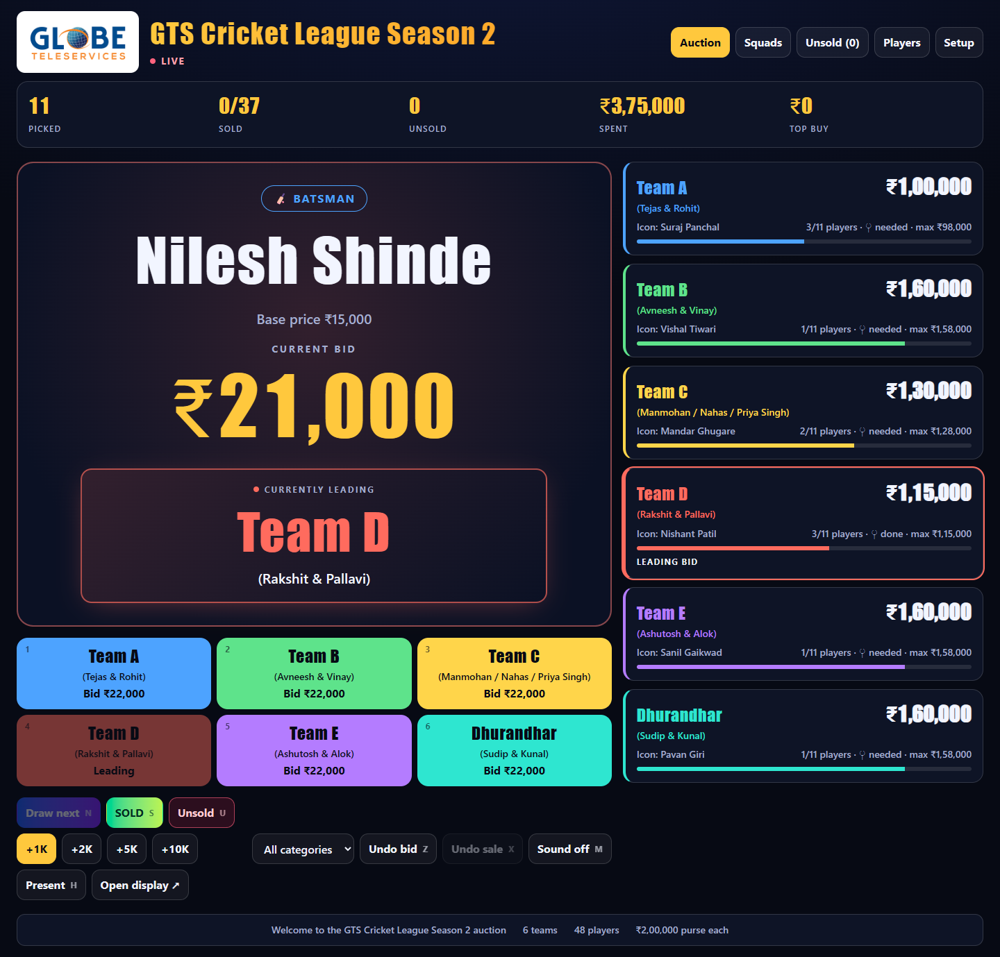
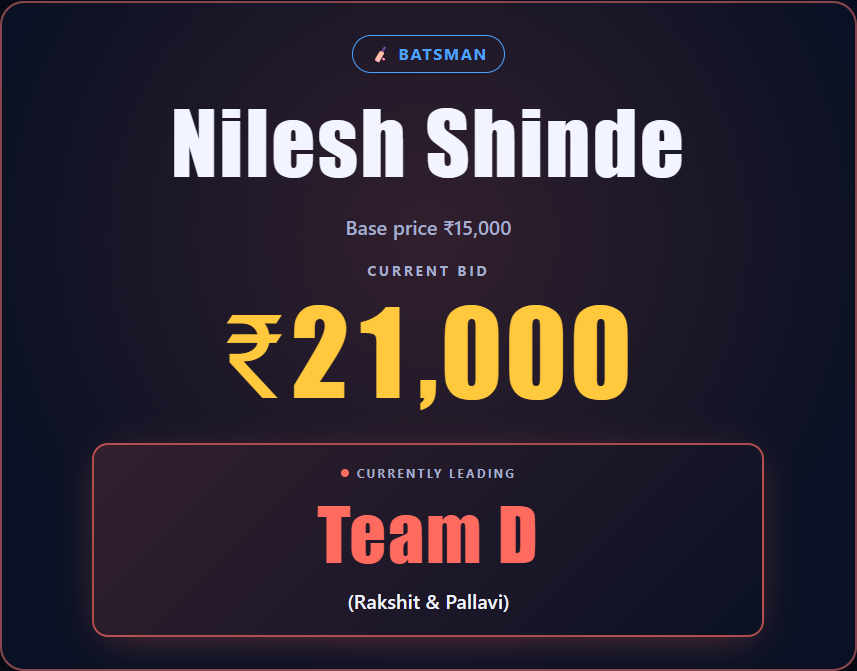
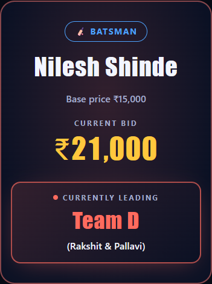
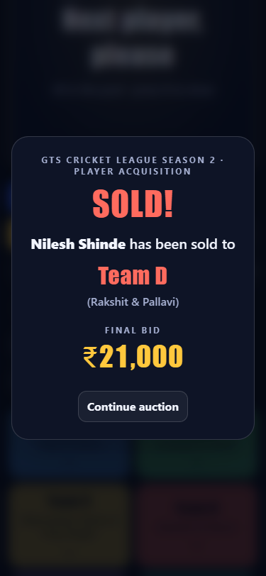
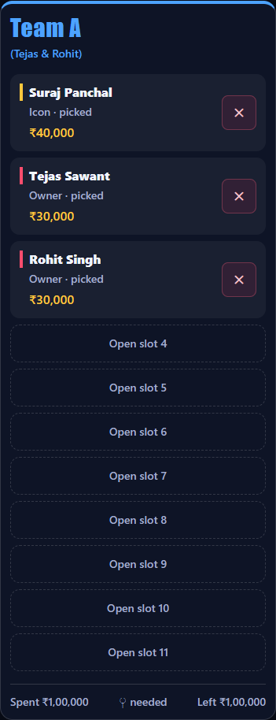
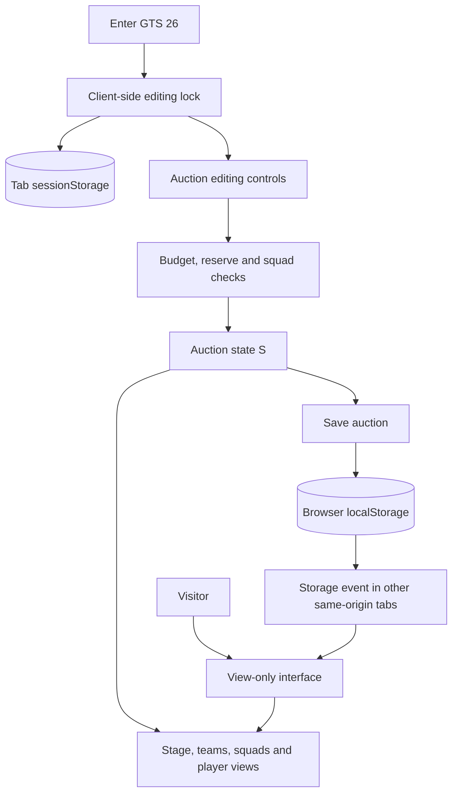
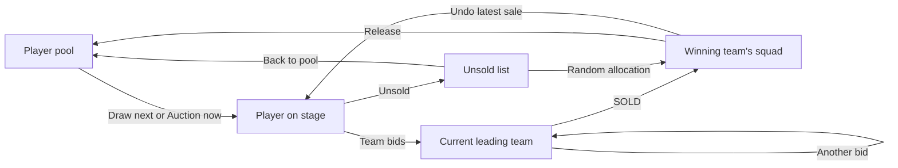

# GTS Cricket League — Season 2

A responsive cricket player auction dashboard for running a league auction from a laptop, following it on a phone, or presenting it on a large screen. Built with HTML, vanilla JavaScript, and locally compiled Tailwind CSS.



## Auction experience

- **Live auction stage:** player name, category, base price, current bid, and a large team-colored panel identifying the leading team and its owners.
- **Team bidding controls:** place bids with buttons or number keys; view remaining purses, roster counts, and the leading team.
- **11-player squads:** pre-signed players count toward the squad size. Full squads cannot acquire another player through bidding, random allocation, or the player editor.
- **Player management:** filter the pool, edit player details, assign teams, release players, re-auction players, and return unsold players to the pool.
- **Sale announcements:** show the player's name, winning team, owners, and final price in a dismissible result dialog.
- **Spoken SOLD results:** with Sound on, the operator's browser says, for example, "Shubham Desai sold to Team A for twenty thousand rupees." Uses an installed English device voice, preferring Indian English, with no added service, API key, server, or package. If no local English voice is available, the existing sale chime plays. Sound off (or `M`) stops narration; undoing the sale also stops it. Re-rendering or refreshing does not replay a sale, and display/viewing tabs do not echo the operator's voice. Voice availability and pronunciation depend on the device. [Local browser voices](https://developer.mozilla.org/en-US/docs/Web/API/SpeechSynthesisVoice/localService).
- **Undo controls:** undo the latest bid or sale. Bid history is retained internally for undo; the small history strip beneath the leading team is intentionally omitted.
- **Presentation and display modes:** hide operator controls for a cleaner audience view, with a touch-friendly exit from presentation mode.
- **Simple editing lock:** everyone starts in viewing mode. Enter **GTS 26** to unlock editing in the current tab. No database, account, or environment variables are needed.
- **Responsive and accessible layouts:** wrapping names, labeled fields, visible keyboard focus, large touch targets, reduced-motion support, and scrollable result dialogs.

### Leading team display

The current leader is the main visual feature beneath the price. It uses the team's color, a large team name, and bracketed owner names. Each new bid or undo updates this panel.



### Mobile views

These are captures of the working interface in an isolated browser session using the included player records.

<p>
  
  
</p>

<details>
<summary>View an 11-slot squad card on mobile</summary>



</details>

## Run locally

Use Node.js 22 or later with npm. From the repository directory:

```bash
npm ci
npm run build
npm run dev
```

Open **http://127.0.0.1:4173**. The preview serves the current source files; rerun the build after changing Tailwind classes or styles, then refresh the browser. Stop the preview with `Ctrl+C`.

The app stores auction progress in this browser. It needs no `.env` file or server setup. Different browser profiles and devices have independent auction data.

The generated stylesheet is committed in `assets/styles.css`, so the HTML can also be served by a basic static server. Styling does not depend on a Tailwind CDN. The existing Google Fonts link loads Bebas Neue and Rajdhani when available, with local font fallbacks.

## Registered player data

The app includes **52 registered players**: 50 from `Auction Rules and Registered Players Data - GTS Cricket League Season 2.xlsx`, sheet **Registered Player Data**, cells **A3:D52**, plus two registrations confirmed by the user: **51 — Shubham Desai, Male / All Rounder (₹20,000)** and **52 — Vikas Tripathi, Male / Bowler (₹10,000)**. Names, registration numbers (including blanks), gender, and the original player role are retained. Amit Nagarkoti is included as **Male / New Player**, as confirmed by the user. The two additional registrations have no workbook source row; retain them when refreshing the workbook import.

The player editor shows the original registered role and gender beneath each name. Auction categories map **Batter** to **Batsman**, female all-rounders to **Female Player**, and **All Rounder/Owner** to **Owner**, while retaining the original role text. Base prices come from the workbook's Player Prices and owner/icon deduction cells.

Existing saved lists update once for this registration revision. Matched players keep their IDs, team assignments, picked/sold prices, statuses, current bids, and sale history. New registrations start unassigned. The unused Kunal Mittal placeholder is removed because it is absent from the supplied list; if that player has auction activity, the record is retained and labeled as outside the current registration. A base-price correction for the player currently on stage takes effect after that auction finishes. Later manual edits are preserved on refresh.

Your **11-slot** setting remains in place; the workbook's older eight-player squad guidance does not override it. Existing fixed/picked prices are retained, so importing registration details does not change team spending.

To refresh from a revised workbook, review any missing fields, then run the read-only importer (Python with `openpyxl`), build and test before deploying:

```bash
python scripts/import_registered_players.py "PATH/TO/WORKBOOK.xlsx"
npm run build
npm test
```

The importer updates `assets/registered-players.js`; it does not modify the Excel workbook. `assets/registration.js` applies the data to the app and migrates saved auction lists.

## Running an auction

1. Open **Setup** to review team names, owners, purse, squad size, bid increment, reserve, and the player list. Applying setup resets the auction and requires a second click on its reset button.
2. Open **Auction**, optionally choose a category, and select **Draw next**.
3. Select a team to place its bid. The price and large leading-team panel update immediately.
4. Select **SOLD** to assign the player to the leading team, or **Unsold** to move the player to the unsold list.
5. Review rosters under **Squads**. Use **Players** and **Unsold** for individual changes or the accelerated round.
6. Use **Show results CSV** under Setup to display the team/player/category/price export for copying.

The starting configuration is a **₹2,00,000 purse**, **11 slots per team**, **₹1,000 bid increment**, and **₹2,000 female-player reserve**. The reserve reduces a team's available bidding budget until its roster includes a female player, except when bidding for a female player.

The initial teams are:

- **Team A** (Tejas & Rohit)
- **Team B** (Avneesh & Vinay)
- **Team C** (Manmohan, Nahas & Priya Singh)
- **Team D** (Rakshit & Pallavi)
- **Team E** (Ashutosh & Alok)
- **Dhurandhar** (Sudip & Kunal)

Team names, owners, and colors can be edited in Setup. The setup parser supports up to eight teams; that team count is separate from the 11 slots per squad.

### Keyboard controls

Shortcuts work outside editable fields. Auction action shortcuts apply on the Auction view.

- `1`–`8`: place a bid for the corresponding team.
- `N`: draw the next player.
- `S` or `Enter`: sell to the leading team.
- `U`: mark the current player unsold.
- `Z`: undo the latest bid.
- `X`: undo the latest sale.
- `M`: toggle sound.
- `H`: toggle presentation mode.
- `Escape`: dismiss an open result dialog.

**Present** hides operator controls in the current tab. **Open display** opens the same auction at `#display` in another tab and follows the operator's Auction/Squads view. **Copy viewing link** copies `/watch`, where viewers can switch between Auction and Squads without changing the editing tab's view.

## Viewing and editing

After deploying this version, use:

- **Editing entry:** https://gts-five.vercel.app/auth
- **Viewing:** https://gts-five.vercel.app/watch
- **Password:** `GTS 26` (including the space; capitalization matters).

1. Open the site. It starts in view-only mode.
2. Select **Unlock editing**, or open `/auth` directly.
3. Enter **GTS 26** to enable bidding, drawing, selling, player changes, and Setup.
4. Select **Lock editing** to return to viewing mode without resetting any auction data.

Unlocking is remembered in the current tab's session storage, so refreshing that tab retains access. `/watch` and `#display` always stay in viewing mode, even when opened from an editing tab.

### What this simple mode does and does not do

The password is intentionally stored in frontend code as requested. It is a convenience lock against accidental edits, **not secure authentication**: someone inspecting or modifying their browser can discover or bypass it. Do not reuse this password for any other account.

Auction changes save under `gts-auction-v3` in browser local storage. Other tabs in the same browser profile on the same site receive changes automatically. **Other phones, computers, browser profiles, and origins do not receive live updates**; sharing a URL does not share browser storage. For an audience on separate devices without a backend, screen-share the auction/display window through your existing meeting app.

No `DATABASE_URL`, `AUCTION_ADMIN_PASSWORD`, migration command, or API connection is required. The previous database/API implementation has been removed. An old Vercel password environment variable is unused and can be left in place or removed without affecting this version.

## Architecture

This version is a static HTML/JavaScript app with locally compiled Tailwind CSS. All auction state, editing access, rendering, and animations run in the browser. Node.js is used only for building, previewing, screenshots, and tests.



### State and persistence

- **Auction data:** configuration, teams, players, current bid and history, sales, result events, and view are retained in `gts-auction-v3`. Unlocking or locking editing does not clear these records.
- **Editing access:** only a `yes` flag is stored under `gts-editing-unlocked-v1` in session storage. The password entered into the form is cleared after use.
- **Existing auctions:** migrations retain players and auction progress while correcting the league title, 11-slot default, team labels, and Team C's owner names.
- **Viewer controls:** bidding/editing controls are hidden, mutation handlers and shortcuts are guarded, and viewer navigation does not save preferences into the auction state. These are UI safeguards, not a server security boundary.

### Player flow



## Project structure

```text
.
|-- index.html                       # Canonical UI and inline auction JavaScript
|-- GTS Cricket League Season 2.html # Synchronized alternative filename
|-- src/styles.css                   # Tailwind theme and shared components
|-- assets/
|   |-- access.js                    # GTS 26 editing lock and viewing link
|   |-- registered-players.js        # Data extracted from the registration workbook
|   |-- registration.js              # Registration metadata and saved-list migration
|   |-- styles.css                   # Generated stylesheet
|   `-- globe-teleservices-logo.jpg  # Bundled header logo
|-- scripts/
|   |-- build.mjs                    # Compile CSS, synchronize HTML, prepare dist
|   |-- import_registered_players.py # Read registration workbook into the data asset
|   |-- serve.mjs                    # Static preview server
|   `-- screenshots.mjs              # Reproduce README screenshots
|-- tests/
|   |-- access.test.mjs              # Editing lock and same-browser viewing
|   `-- ui.test.mjs                  # Responsive auction regression checks
|-- docs/images/                     # Committed UI screenshots
|-- vercel.json                      # Static build and auth/watch routes
|-- package.json
`-- package-lock.json
```

`dist/`, `node_modules/`, and `test-results/` are generated and ignored by Git.

### Editing and building

Edit **`index.html`** for markup, Tailwind utility classes, and auction behavior. Edit **`src/styles.css`** for theme tokens and shared styles. Then run:

```bash
npm run build
```

The build compiles Tailwind into `assets/styles.css`, copies the canonical HTML to the alternative filename, and prepares both HTML files plus all local assets under `dist/`. Make changes to the canonical file so the next build retains them.

## Testing

```bash
npm test
```

The suite uses installed Chrome/Edge on Windows, `CHROME_PATH` if supplied, or Playwright's Chromium. If no browser is available, install the Playwright browser once:

```bash
npx playwright install chromium
```

Checks cover all five views across phone, tablet, desktop, and landscape sizes; text reflow; long names; larger text; bid/undo/sold/unsold flows; 11-player squads; saved-state corrections; result dialogs; presentation/display modes; and the enlarged leading team. Access checks cover default viewing, rejected passwords, GTS 26 unlocking, refresh/locking behavior, data preservation, draw cancellation when locking, same-browser display updates, and the absence of API/database requests. Tests use isolated browser storage and block external font requests to verify fallback fonts. Screenshots go to `test-results/`.

### Refresh the README images

```bash
npm run build
npm run screenshots
```

The screenshot script starts a temporary server and browser profile, stages Nilesh Shinde with Team D leading at ₹21,000, captures the desktop/mobile interface and sold result, then closes its resources. It updates the five committed images in `docs/images/` without touching an existing browser's auction data.

## Deployment

The Vercel configuration runs **`npm run build`**, serves **`dist/`**, and maps `/auth` and `/watch` to the same static app. Deploy the repository to the existing project; no database or environment variables are needed. Other static hosts can serve `dist/` if they map these two paths to `index.html`.

## Branding

The header displays the Globe Teleservices logo beside **GTS Cricket League Season 2**. The logo is bundled locally and keeps its original proportions and colors on a white panel. Its source is the [Globe Teleservices press-release logo](https://mma.prnewswire.com/media/2155167/Globe_Teleservices_Logo.jpg). Existing auctions using the former GTS Premier League title are renamed automatically without resetting auction progress.
